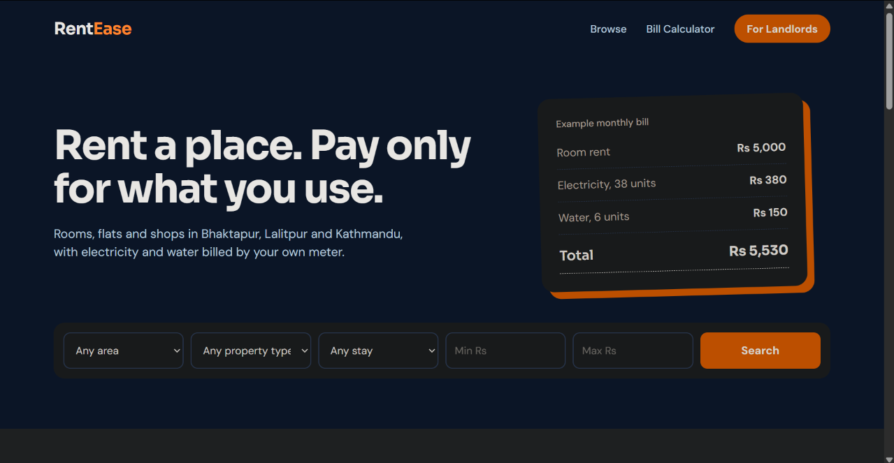

# RentEase

**Rent a place. Pay only for what you use.**

RentEase is a rental listing website for Nepal. Renters can search rooms, flats, houses and shops by area, budget and stay type, and calculate a fair monthly bill where electricity and water are charged by actual meter usage. Landlords can list a property in under a minute.

**Live demo:** [(https://alwinacodes.github.io/rentease/)]

## The problem

Finding a room in Nepal usually means word of mouth and scattered posts. Renters often can't search by budget, stay length or tenant type. Utility bills are another common source of disputes: water and electricity depend on how much each tenant actually uses, yet they are often split unfairly or charged as a flat amount.

## What it does

- **Search and filter** by area (Bhaktapur, Lalitpur, Kathmandu), property type, stay type (temporary or permanent) and budget range
- **Property types:** apartment flats, entire houses, single rooms and shop spaces
- **Fair bill calculator:** rent plus electricity and water, each calculated from the tenant's own meter readings
- **Landlord form:** add a new listing that appears instantly and is saved in the browser
- **Responsive design** that works on phones and laptops

## Built with

- HTML, CSS and JavaScript (no frameworks)
- Browser localStorage for saving listings
- GitHub Pages for hosting

## Run it on your computer

Download or clone this repository, then open the file `index.html` in any web browser. No installation is needed.

## Future improvements

- A real back end and database so landlords and renters share live data
- Slab-based electricity rates, matching how real bills work in Nepal
- Rent payment tracking and reminders for landlords
- Photos, map view and contact buttons for each listing
- Roommate matching for students and office workers
- Nepali language option

## Author

Built by [ALWINA SHAKYA], Computer Engineering student at Khwopa College of Engineering, as a hackathon project.